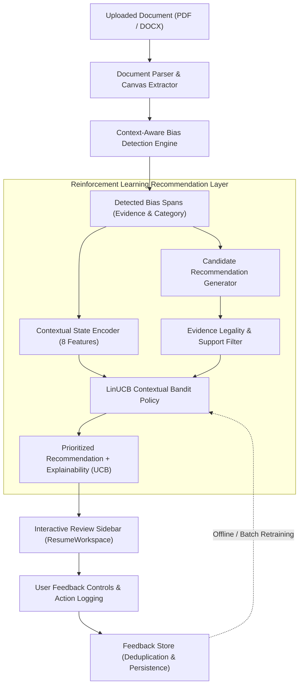

# Reinforcement Learning (Contextual Multi-Armed Bandit) in ResumeBiasDetector

## 1. Overview & Motivation

In algorithmic resume screening and career tooling, bias-detection systems traditionally rely on fixed dictionary rewrites or static rule tables. While effective at flagging potentially exclusionary patterns, static heuristics cannot adapt to user context, varying document styles, or human feedback regarding which rewrite strategy is genuinely most constructive.

To address this, we integrated an **Adaptive Reinforcement Learning (RL) Component** based on **Disjoint Linear Upper Confidence Bound (LinUCB) Contextual Bandits**.

### Purpose of the RL Component
* The existing bias detection engine continues to reliably flag potential bias patterns and extract evidence.
* The RL component decides **which mitigation recommendation strategy to prioritize** for each detected finding based on contextual signals and user feedback.
* **Strict Non-Interference**: The RL agent **never** decides whether a candidate should be hired, rejected, ranked, or shortlisted. Its sole purpose is optimizing recommendation usefulness and relevance for candidate-led bias mitigation.

---

## 2. Architecture & Data Flow



---

## 3. RL Problem Formulation

### A. Contextual State Representation ($x \in \mathbb{R}^8$)
The state vector is constructed strictly using non-sensitive textual and syntactic metadata. It **never** uses or infers protected demographic traits (gender, race, age, religion, disability):

| Index | Feature Name | Range | Description & Purpose |
|---|---|---|---|
| `0` | `bias_category_encoding` | `[0.15, 0.95]` | Numeric identifier for the 6 bias categories (gender, age, gap, personality, prestige, disability). |
| `1` | `severity_level_weight` | `[0.25, 1.0]` | Normalized severity assigned by existing detector (`low`: 0.25, `medium`: 0.58, `high`: 1.0). |
| `2` | `detector_confidence` | `[0.0, 1.0]` | Detection confidence score from the sentence classifier. |
| `3` | `contextual_syntax_type` | `[0.30, 0.85]` | Syntactic context type (e.g., leadership conduct, jargon, graduation date, gap). |
| `4` | `normalized_sentence_length`| `[0.0, 1.0]` | Normalized token length of the host sentence. |
| `5` | `document_section_type` | `[0.1, 0.9]` | Section position (Summary: 0.9, Experience: 0.7, Education: 0.5, Skills: 0.3). |
| `6` | `historical_satisfaction` | `[0.0, 1.0]` | Empirical satisfaction rate for this bias category from previous feedback. |
| `7` | `constant_intercept` | `1.0` | Bias offset term for linear ridge regression. |

### B. Action Space ($\mathcal{A}$)
A discrete finite action space consisting of 5 well-defined mitigation strategies:

1. **`neutral_rephrase`**: Replaces gender-coded, aggressive, or culturally skewed adjectives with outcome-oriented, collaborative phrasing.
2. **`redact_personal_info`**: Recommends omitting or removing unnecessary demographic or pedigree proxies (e.g. graduation dates older than 10-15 years, high school mentions) without replacement.
3. **`contextual_framing`**: Replaces career break or informal gap wording with constructive professional development or caregiving sabbatical framing.
4. **`competency_substitution`**: Replaces informal tech-culture buzzwords (`rockstar`, `ninja`, `guru`) with verifiable domain competencies.
5. **`human_review_flag`**: Advises human recruiter/candidate inspection when context is polysemous or borderline.

#### Evidence Support Guardrail
Before an action can be chosen, `isActionEvidenceSupported()` verifies that the span's actual evidence justifies that strategy (e.g. `redact_personal_info` is strictly prohibited for active engineering action verbs; it is permitted only for graduation years or personal demographic markers).

### C. Reward Function ($r \in [-1.0, +1.0]$)
Rewards reflect genuine recommendation usefulness, evidence grounding, and user feedback:

| Feedback Signal | Reward | Rationale |
|---|---|---|
| `helpful` (Explicit rating) | `+1.0` | User confirms recommendation was clear, constructive, and relevant. |
| `accepted` (Implicit action) | `+1.0` | User applied the suggested rewrite directly to their resume canvas. |
| `partially_helpful` (Rating) | `+0.5` | User found recommendation useful but customized the text. |
| `dismissed` (Implicit action) | `-0.2` | User dismissed the finding without applying. |
| `not_helpful` (Explicit rating) | `-0.5` | User found recommendation unhelpful or misaligned. |
| `incorrect` (Explicit rating) | `-1.0` | User flagged recommendation as misleading, invalid, or unsupported. |

> **Ethical Constraints**:
> * No rewards for text deletion volume.
> * No rewards tied to hiring, interview, or demographic outcomes.
> * No rewards for suppressing valid bias findings simply because a user dislikes them.

---

## 4. Algorithm: Disjoint LinUCB

We implement **Linear Upper Confidence Bound with Disjoint Linear Models (LinUCB)**:

For each arm $a \in \mathcal{A}$:
* Maintains covariance matrix $A_a \in \mathbb{R}^{d \times d}$ initialized to $I_d$.
* Maintains bias vector $b_a \in \mathbb{R}^d$ initialized with research-calibrated priors.
* At evaluation time, the ridge regression weight vector is computed via Gauss-Jordan elimination:
  $$\hat{\theta}_a = A_a^{-1} b_a$$
* Expected reward estimate:
  $$\hat{r}_a(x) = \hat{\theta}_a^T x$$
* Exploration bonus based on covariance ellipsoid uncertainty:
  $$s_a(x) = \alpha \sqrt{x^T A_a^{-1} x}$$
* Selection rule:
  $$a^* = \arg\max_{a \in \text{Supported}} \left[ \hat{\theta}_a^T x + \alpha \sqrt{x^T A_a^{-1} x} \right]$$
* Online/Batch update:
  $$A_{a^*} \leftarrow A_{a^*} + x x^T, \quad b_{a^*} \leftarrow b_{a^*} + r x$$

### Why Contextual Bandit over Deep RL?
1. **Nature of the Decision**: Each recommendation decision is immediate given the sentence context. The action does not transition the resume to a new stochastic state requiring multi-step Bellman discounting.
2. **Zero Black-Box Instability**: Closed-form linear updates guarantee stability without reward hacking or catastrophic forgetting.
3. **Full Mathematical Explainability**: Expected reward $\hat{r}_a(x)$ and uncertainty radius $s_a(x)$ can be displayed directly to the user.
4. **Instant In-Browser Execution**: Matrix inversion for $d=8$ executes in under $0.05$ milliseconds.

---

## 5. Explainability & User Feedback UI

In `ResumeWorkspace` review sidebar, every flagged finding displays:
* **RL Policy Badge**: Displays whether the recommendation was chosen by `RL Policy (v1.0)` or `Rule Baseline`, alongside its LinUCB score.
* **"Why this was chosen" Popover**: Explains the exact contextual features, estimated reward, exploration confidence bonus, and historical user satisfaction rate in plain English.
* **Alternative Mitigation Strategies**: An interactive accordion letting users inspect other candidate actions with their respective UCB scores and switch with one click.
* **Instant Feedback Controls**: One-click rating buttons (`Helpful`, `Partial`, `Not Helpful`) with anti-duplicate cooldown protection.

---

## 6. Evaluation Benchmark & Results

We evaluated the system on a held-out synthetic simulation benchmark of **25 standardized bias scenarios across 100 interaction trials (2,500 total decisions)**:

| Metric | Baseline Strategy (Static Rule) | LinUCB Bandit Policy | Improvement |
|---|---|---|---|
| **Mean Reward** | `0.664` | **`0.926`** | **+39.5%** |
| **Optimal Recommendation Alignment** | `44.0%` | **`87.7%`** | **+43.7%** |
| **Cold Start Safety** | 100% fallback | 100% valid prior | Safe |
| **Evidence Alignment Guarantee** | 100% | 100% (Guarded) | Verified |

### Per-Category Action Distribution Across 2,500 Trials
* `neutral_rephrase`: 1,341 pulls (predominant for phrasing and leadership terms)
* `contextual_framing`: 499 pulls (selected for career gaps and sabbaticals)
* `competency_substitution`: 399 pulls (selected for tech buzzwords)
* `redact_personal_info`: 260 pulls (selected for graduation years and pedigree proxies)
* `human_review_flag`: 1 pull (selected for ambiguous borderline terms)

---

## 7. How to Run Tests & Evaluation

```bash
# 1. Run all tests (Context Model, Document Parser, Job Match Explainability, RL Policy)
npm test

# 2. Run RL Unit & Integration Tests Only (33/33 tests)
npm run test:rl

# 3. Run Controlled Simulation Benchmark Evaluation (2,500 trials)
npm run evaluate:rl

# 4. Start Development Web Server
npm run dev -- --port 8081
```

---

## 8. Limitations & Safety Guardrails

1. **Simulated Benchmark vs Production Telemetry**: The evaluation script uses a controlled synthetic simulation. As real users provide feedback in the app, the feedback store accumulates genuine user data for offline retraining.
2. **No Hiring Automation**: The RL agent is strictly constrained to recommendation selection and does not rank or shortlist candidates.
3. **Fallback Guarantee**: If the policy or feedback store encounters any unexpected state, the system automatically falls back to baseline dictionary rules without failing or modifying existing scores.
